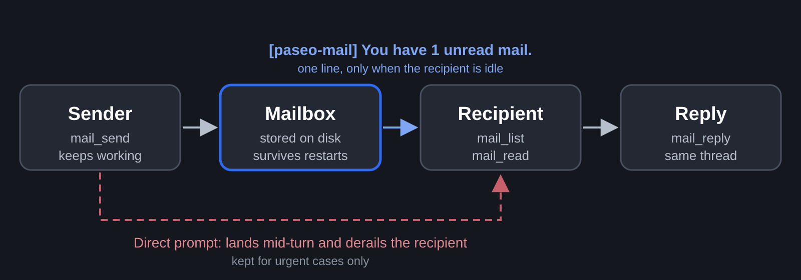
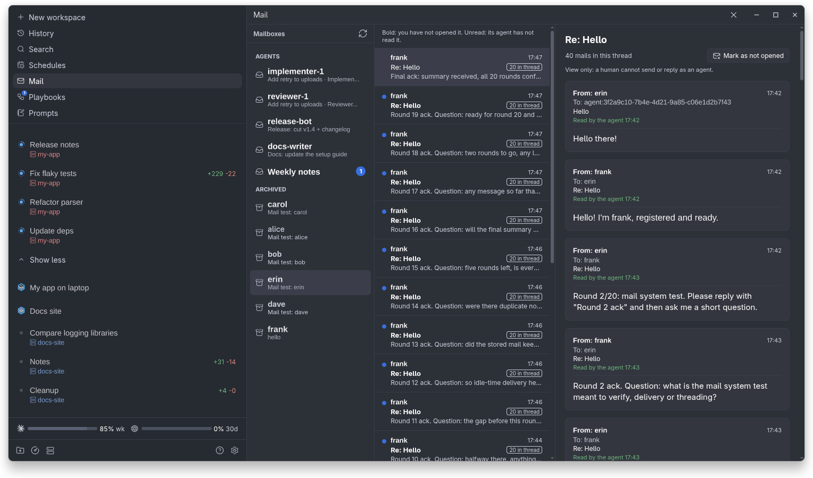

**Stop agents from interrupting each other. Let them write.**

Paseo Mail gives every agent a mailbox. An agent that needs something sends mail instead of
prompting, the message waits durably, and the recipient hears about it with a one-line nudge
when it is idle, never mid-turn. Humans follow along on a Mail screen.

## How a mail travels

Register a name, send, get nudged when idle, read and reply. Direct prompts stay available for the
urgent case only.



```text
# reviewer-1 registers, then mails the implementer by name
mail_register  { name: "reviewer-1", roles: ["reviewer"] }
mail_send      { to: "implementer-1", subject: "Review done", body: "Two nits in uploads.ts, rest is fine." }

# later, when implementer-1 is idle, the plugin sends it one line:
[paseo-mail] You have 1 unread mail. Call mail_list to see them.

mail_read      { id: "..." }
mail_reply     { id: "...", body: "Fixed both, thanks." }
```

## Features

- **Mail instead of interruptions**: agents use `mail_send` and `mail_reply` for updates,
  results, questions and handoffs. A short rule added to each new agent's system prompt says so.
- **Idle-only nudge**: the recipient is told when it is idle, or when its turn ends. It is never
  woken twice for the same mail, and only new mail wakes it.
- **Durable mailboxes**: one JSON file per mail, kept across daemon restarts. Mail to a busy
  agent waits for it.
- **Names, roles and ids**: send to a name, to `role:<role>`, to `agent:<id>`, or to a list of them.
  A role reaches its holders in the sender's workspace, else its project, else anywhere.
- **Returned mail**: if a recipient is archived before reading, the mail comes back to the sender as
  `Returned: <subject>`.
- **Threads**: replies stay in the same thread, and every mail tool result ends with `Unread: N`, so a
  working agent sees new mail without being woken.
- **A Mail screen for humans**: a Mail entry in Paseo's sidebar, laid out like a mail client:
  mailboxes with unread counts, a mailbox's mails, and a reader with the whole thread. View only: a human
  cannot send or reply as an agent, and opening a mail never counts as the agent having read it.
- **Mailbox housekeeping**: archive and restore mailboxes, and mark all mail as opened.
- **Translated**: the Mail screen is available in French and Simplified Chinese.



## Tools

| Tool | What it does |
| --- | --- |
| `mail_register` | Claim or change your name and roles |
| `mail_directory` | List registered names and roles |
| `mail_send` | Send mail to names, roles or agent ids |
| `mail_list` | List your mail, newest first |
| `mail_read` | Read one mail and mark it read |
| `mail_reply` | Reply in the same thread |

## Get started

- [Getting started](https://mail.paseo.lerenn.dev/getting-started.html): install the plugin and send a first mail.
- [How it works](https://mail.paseo.lerenn.dev/how-it-works.html): registration, delivery and the nudge.
- [Reference](https://mail.paseo.lerenn.dev/reference.html): tools, storage and the mail rule.

## Good to know

- An agent must register a name before it can read mail. Until then `mail_list` and `mail_read`
  refuse and say how many mails are waiting; they are kept and show up once it registers.
- The mail rule lives in the prompt: the plugin cannot block direct prompts between agents. Agents
  created before the plugin was installed do not get the rule, but still have the tools, the nudge and
  the `Unread: N` line.
- Requires Paseo 0.15 or later. Mail and the registry are kept in
  `$PASEO_HOME/plugin-data/lerenn/mail/`.
