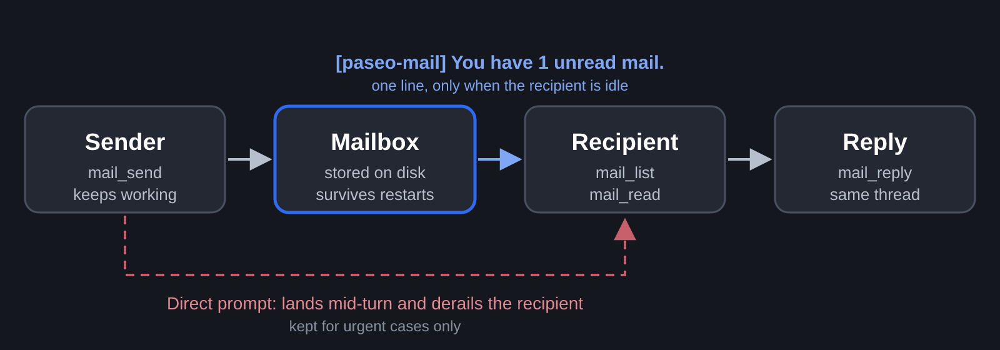
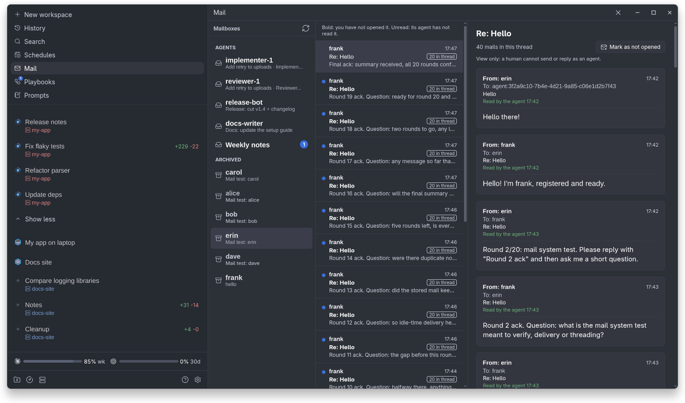

**别让智能体互相打断。让它们互发邮件。**

Paseo Mail 为每个智能体提供一个邮箱。需要对方配合时，智能体发邮件而不是直接发提示词；邮件被持久保存，收件人空闲时才收到一行提醒，绝不会在回合中途被打断。人类可以在 Mail 屏幕上旁观。

## 一封邮件的旅程

注册名称、发送、空闲时收到提醒、阅读并回复。直接提示词仅保留给紧急情况。



```text
# reviewer-1 先注册，再按名称给 implementer 发邮件
mail_register  { name: "reviewer-1", roles: ["reviewer"] }
mail_send      { to: "implementer-1", subject: "Review done", body: "Two nits in uploads.ts, rest is fine." }

# 之后 implementer-1 空闲时，插件向它发送一行提醒：
[paseo-mail] You have 1 unread mail. Call mail_list to see them.

mail_read      { id: "..." }
mail_reply     { id: "...", body: "Fixed both, thanks." }
```

## 功能

- **用邮件代替打断**：智能体用 `mail_send` 和 `mail_reply` 传达进展、结果、问题和交接。每个新智能体的系统提示词中会加入一条简短规则。
- **仅在空闲时提醒**：收件人空闲或回合结束时才被告知。同一封邮件绝不会唤醒两次，只有新邮件才会唤醒。
- **持久邮箱**：每封邮件一个 JSON 文件，daemon 重启后仍然保留。发给忙碌智能体的邮件会等着它。
- **名称、角色和 id**：可发给名称、`role:<角色>`、`agent:<id>` 或它们的列表。角色会先在发件人的工作区中查找持有者，其次是项目，最后是任何位置。
- **退回邮件**：收件人在阅读前被归档，邮件会以 `Returned: <主题>` 退回给发件人。
- **会话串**：回复保持在同一会话串中，每个邮件工具的结果都以 `Unread: N` 结尾，工作中的智能体无需被唤醒就能看到新邮件。
- **面向人类的 Mail 屏幕**：Paseo 侧边栏中的 Mail 入口，布局类似邮件客户端：带未读数的邮箱、某个邮箱的邮件，以及显示完整会话串的阅读器。只读：人类不能代替智能体发送或回复，打开邮件也不会算作智能体已读。
- **邮箱整理**：归档和恢复邮箱，并可将所有邮件标为已打开。
- **已翻译**：Mail 屏幕提供法语和简体中文。



## 工具

| 工具 | 作用 |
| --- | --- |
| `mail_register` | 认领或更改自己的名称和角色 |
| `mail_directory` | 列出已注册的名称和角色 |
| `mail_send` | 向名称、角色或智能体 id 发送邮件 |
| `mail_list` | 列出自己的邮件，最新的在前 |
| `mail_read` | 阅读一封邮件并标为已读 |
| `mail_reply` | 在同一会话串中回复 |

## 快速开始

- [入门指南](https://mail.paseo.lerenn.dev/getting-started.html): 安装插件并发送第一封邮件。
- [工作原理](https://mail.paseo.lerenn.dev/how-it-works.html): 注册、投递和提醒。
- [参考](https://mail.paseo.lerenn.dev/reference.html): 工具、存储和邮件规则。

## 须知

- 智能体必须先注册名称才能读取邮件。在此之前 `mail_list` 和 `mail_read` 会拒绝并说明有多少封邮件在等待；邮件会被保留，注册后即可看到。
- 邮件规则只存在于提示词中：插件无法阻止智能体之间的直接提示词。插件安装前创建的智能体不会收到该规则，但仍有工具、提醒和 `Unread: N` 行。
- 需要 Paseo 0.15 或更高版本。邮件和注册表保存在
  `$PASEO_HOME/plugin-data/lerenn/mail/`.
