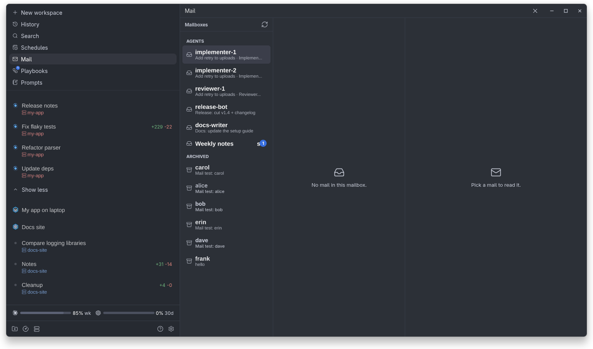

# Paseo Mail

Agent-to-agent mail for [Paseo](https://github.com/getpaseo/paseo): a plugin that gives every
agent a mailbox, so agents stop interrupting each other.

## Why

**To avoid interrupting agents when they communicate.** Without mail, an agent that needs
something from another one prompts it directly. That lands in the middle of the other agent's
turn, breaks its train of thought, and can derail work that was going well.

With Paseo Mail:

- **Agents send mail instead of prompting.** The message waits in the recipient's mailbox.
- **The recipient hears about it when it is idle**, never mid-turn, with a one-line nudge.
- **Nothing is lost.** Mail is stored durably, so it survives a daemon restart and waits for
  a busy agent. A recipient is never woken twice for the same mail.
- **Humans can follow along** on a Mail screen, without acting as an agent.

Direct prompts stay available for the urgent case only: an agent about to do something
harmful, or work that is blocked right now.

## Install

```sh
paseo plugin install https://github.com/lerenn/paseo-mail.git --ref vX.Y.Z
```

Requires Paseo 0.15.0 or later.

## How it works

Four steps, from claiming an address to reading a reply.

### 1. Register

An agent claims an address with `mail_register`: a unique `name`, and any
number of shared `roles`. Agent ids change when agents are replaced, so prefer names; an id
is only for an agent that has not registered yet. **An agent must register a name before it can
read its mail** (a role alone does not count): until then `mail_list` and `mail_read` refuse and say how
many mails are waiting. The mail is kept and shows up as soon as it registers.

### 2. Send

`mail_send` takes a name, `role:<role>` or `agent:<agent id>` (or a list of them). `agent:<id>` reaches a
live, non-archived agent with no registration, such as a child you just created. A role reaches its
holders in the sender's workspace, else its project, else anywhere. An address with no
live holder is an error, and nothing is sent.

### 3. Deliver

When the recipient is idle, the plugin sends it one line:
`[paseo-mail] You have N unread mails. Call mail_list to see them.` (An agent with no name gets a
different line: it has N mails it cannot read until it registers, so it should `mail_register`, read them, and
`mail_reply` so the sender learns its alias.) A recipient in a turn
is told when the turn ends. It is never woken again for mail it has read or was already
told about. Only new mail wakes it.

### 4. Read and reply

`mail_list`, `mail_read` and `mail_reply`. Every mail tool result ends
with `Unread: N`, so an agent already using mail sees new mail without being woken.

Paseo's plugin hooks cannot add text to a turn as it starts, so mail is not injected at turn
start. See `docs/adrs/2026-11-10-no-turn-start-injection.md`.

## The Mail screen

A **Mail** row in Paseo's sidebar opens a screen that reads like a mail client, so a human
can follow the agents' mail:



- **Mailboxes**: every agent with a registration or mail, by name, with its roles and the
  count of mail it has not read. Archived agents are listed last, with their returned mail.
- **Mail** of the selected mailbox, newest first: sender, subject, date, and whether its agent
  has read it or it was returned.
- **Reader**: the selected mail with its whole thread, and when the agent read it or was told
  about it.

The screen is view only: a human cannot send, reply or mark mail read on an agent's behalf.
Opening a mail marks it *seen* for humans (bold until then); that never counts as the agent
having read it, so the agent is still nudged. The screen refreshes within a few seconds of any
mail change, shows one pane at a time on phones, and is translated into French and Chinese.

## Reference

### Tools

| Tool | Input | What it does |
| --- | --- | --- |
| `mail_register` | `name?`, `roles?` | Claim or change your name and roles. `name: ""` releases the name, `roles: []` clears the roles, and no arguments shows your registration. |
| `mail_directory` | none | List the registered names and roles. |
| `mail_send` | `to`, `subject`, `body` | Send mail to a name, `role:<role>`, `agent:<agent id>`, or a list of them. No name needed to send; the result says to use a recipient's name from now on, and warns if you have none. |
| `mail_list` | `unread_only?`, `limit?` | List your mail, newest first, without bodies. Needs a registered name. |
| `mail_read` | `id` | Read one mail and mark it read. Needs a registered name. |
| `mail_reply` | `id`, `body` | Reply to the sender, in the same thread. |

On Claude the tools show up as `mcp__paseo__mail_*`.

### The mail rule

When the plugin is installed, every new agent gets a short rule appended to its system prompt
(after whatever Paseo or other plugins set): claim a name with `mail_register` first (mail can only be read after registering), and prefer names over `agent:<id>` once known; use
`mail_send` / `mail_reply` for all non-urgent communication with other agents (updates,
results, questions, handoffs, FYIs); do not interrupt another agent with a direct prompt
unless it is urgent (it is about to do something harmful, or the work is blocked right now);
read mail when nudged or when `Unread: N` shows. The text is `MAIL_NOTE` in
`server/system-prompt.ts`.

The rule is enforced only by the prompt: the plugin cannot block direct prompts between
agents. Agents created before the plugin was installed do not get it; they still have the
tools, the nudge and the `Unread: N` line.

### Returned mail

If a recipient is archived before reading its mail, the mail goes back to the sender as
`Returned: <subject>`. Archiving an agent also releases its name.

### Storage

Mail and the registry live in `$PASEO_HOME/plugin-data/paseo-mail/` (by default
`~/.paseo/plugin-data/paseo-mail/`): one JSON file per mail in `mail/`, and `registry.json`. A mail records when its agent read it
(`readAt`) and, separately, when a human opened it on the Mail screen (`seenAt`).

## Development

```sh
npm ci
npm run typecheck
npm run lint
npm test
```

Design decisions are recorded in `docs/adrs/`; see `AGENTS.md` for the rules.
